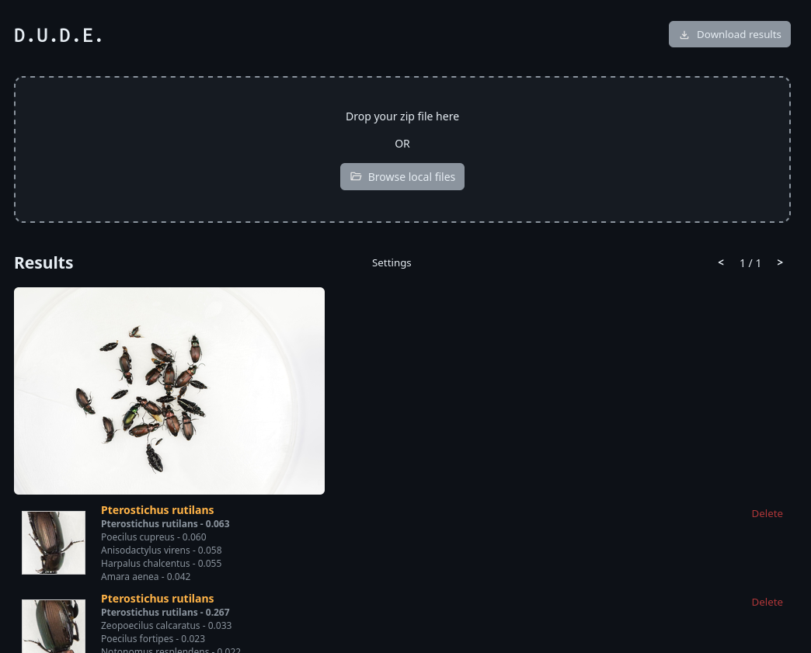

  <h1 align="center">D.U.D.E.</h1>
  

    <i align="center">Digital unified detection for entomologists</i>
  

   

This app leverages Flatbug and BioClip2 to detect and identify insect species.

- Upload images in .zip format
- Let the algorithm detect and identify insects for you
- Edit annotations and delete false positive if needed
- Download the results using a standard annotation format

  

## Quick start

Install using Docker compose. After cloning the repo, just enter the command:

  <code>docker compose up -d</code>

The models can take several minutes to download. For faster download of the models, I recommend using a HuggingFace token (create one here: [https://huggingface.co/settings/tokens](https://huggingface.co/settings/tokens)). First, create a .env file from the .env.example file:

  <code>cp .env.example .env</code>

Then, add your token into the .env file.

After initial configuration, the app can be accessed locally here: [http://localhost:3000/](http://localhost:3000/)

<h3>GPU acceleration</h3>

For inference to run properly, it is recommended to have an NVIDIA GPU with [CUDA](https://developer.nvidia.com/cuda-downloads) installed on the machine running the service. You will also need to install the [NVIDIA Container Toolkit](https://docs.nvidia.com/datacenter/cloud-native/container-toolkit/latest/install-guide.html) which is needed to run GPU-accelerated containers.

<h3>Using</h3>

To use the app with your own photos, upload a .zip file containing all your images in PNG or JPEG format. You can also test the app with the provided test files (./Test_files).
